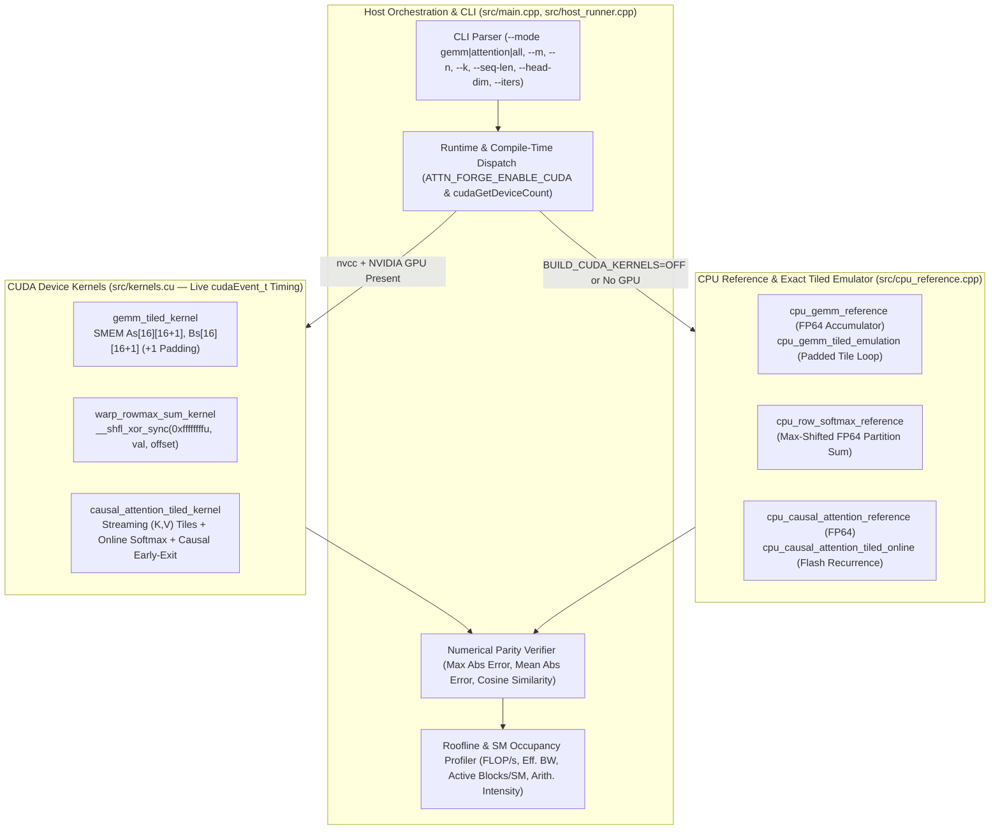

# `cuda-flash-attn-forge`: Tiled GEMM, Warp-Primitive & Causal Attention CUDA Kernel Engine

[](https://github.com/Aanuoluwapo1/cuda-flash-attn-forge/actions/workflows/ci.yml)
[](https://en.cppreference.com/w/cpp/17)
[](https://developer.nvidia.com/cuda-toolkit)
[](https://cmake.org/)
[](https://opensource.org/licenses/MIT)

**`cuda-flash-attn-forge`** is a modular, zero-dependency **C++17 + CUDA Kernel Engine** engineered from first principles. It implements shared-memory tiled General Matrix Multiplication (`gemm_tiled_kernel`) with `+1` bank-conflict padding, register-level butterfly warp shuffle reductions (`warp_rowmax_sum_kernel` via `__shfl_xor_sync`), and FlashAttention-style tile-wise online softmax causal scaled dot-product attention (`causal_attention_tiled_kernel`) that eliminates $O(N^2)$ intermediate HBM materialization.

Every kernel is paired with an exact **`float64`-accumulated CPU reference verifier** (`cpu_reference.cpp`), a hardware-portable **CPU/host tiled fallback execution engine** (`BUILD_CUDA_KERNELS=OFF` or when `nvcc` is unavailable), and an analytical **SM Occupancy & Roofline Arithmetic Intensity Profiler**.

---

## 1. System Architecture & Execution Pipeline



### Memory Hierarchy & Flash-Style Tiled Attention Dataflow

```text
Global Memory (HBM / DRAM)                   On-Chip Shared Memory (SRAM)              Thread Registers (RF)
──────────────────────────                   ────────────────────────────              ─────────────────────
Q : [B*H, N, D]  ──────────────────────────► (Direct Coalesced Load) ────────────────► q_reg[D] (Resident for row i)
                                                                                       o_acc[D] = {0.0f}
                                                                                       m_i = -inf, l_i = 0.0f

K : [B*H, N, D]  ──► Tile t (16 x D) ──────► __shared__ float s_K[16][128 + 1] ──────► S_ij = (q_reg · s_K[t]) / sqrt(D)
V : [B*H, N, D]  ──► Tile t (16 x D) ──────► __shared__ float s_V[16][128 + 1]         m_new = max(m_i, max_t(S_ij))
                     (Skipped if t*16 > i)   (+1 stride prevents 32-way bank conflict) alpha = exp(m_i - m_new)
                                                                                       o_acc = alpha * o_acc + sum(P_ij * s_V[t])
                                                                                       l_i   = alpha * l_i   + sum(P_ij)

Out : [B*H, N, D] ◄───────────────────────── (Final Normalized Writeback) ◄─────────── Out[i, d] = o_acc[d] / l_i
```

---

## 2. Mathematical Foundations & Hardware Microarchitecture

### 2.1 Shared-Memory Tiled GEMM & Bank-Conflict Elimination (`gemm_tiled_kernel`)

Given row-major matrices $A \in \mathbb{R}^{M \times K}$, $B \in \mathbb{R}^{K \times N}$, and $C \in \mathbb{R}^{M \times N}$, the kernel computes:

$$C_{i,j} = \alpha \sum_{t=0}^{\lceil K / T_K \rceil - 1} \sum_{k=0}^{T_K - 1} A_{i,\; t \cdot T_K + k} \, B_{t \cdot T_K + k,\; j} + \beta C_{i,j}$$

where $T_M = T_N = T_K = 16$ (`256` threads = `8` warps per thread block).

#### Shared-Memory Bank Conflict Mechanics & `+1` Stride Skewing
NVIDIA GPUs partition shared memory into **32 banks** of width `4 bytes` (`sizeof(float)`), where consecutive 32-bit words map to successive banks:

$$\text{Bank}(\text{row}, \text{col}) = \left(\text{row} \cdot \text{STRIDE} + \text{col}\right) \bmod 32$$

| Shared Memory Layout | Row Stride (`floats`) | Bank Mapping for Column Access `(ty = 0..15, fixed col)` | Warp Conflict Degree |
| :--- | :---: | :--- | :---: |
| **Unpadded** `As[16][16]` | `16` | `(ty * 16 + col) mod 32` $\in \{\text{col}, (\text{col}+16)\bmod 32\}$ | **8-way / 16-way Bank Conflict** across half-warps |
| **Unpadded** `As[32][32]` | `32` | `(ty * 32 + col) mod 32 = col` | **32-way Bank Conflict** (all 32 threads hit 1 bank) |
| **Padded (`cuda-flash-attn-forge`)** `As[16][16 + 1]` | `17` | `(ty * 17 + col) mod 32` ($\gcd(17, 32) = 1$) | **Conflict-Free (1-way)** — every row shifts by $+1$ bank |

Because $\gcd(17, 32) = 1$ (and in the attention kernel $\gcd(129, 32) = 1$ for `MAX_HEAD_DIM + 1 = 129`), any strided column access across rows maps to distinct shared-memory banks.

---

### 2.2 Register-Level Warp Butterfly Reductions (`warp_rowmax_sum_kernel`)

Standard softmax $\text{softmax}(x)_i = \frac{e^{x_i}}{\sum_j e^{x_j}}$ overflows `float32` whenever $x_i > 88.72$. `warp_rowmax_sum_kernel` assigns one hardware warp (`32` threads) per row and executes a three-pass numerically stabilized reduction:

1. **Thread-Strided Local Maximum & Warp Butterfly All-Reduce:**
   $$m_{\text{lane}} = \max_{k \equiv \text{lane} \pmod{32}} x_k, \qquad m = \text{WarpReduceMax}(m_{\text{lane}})$$
2. **Shifted Partition Sum & Warp Butterfly All-Reduce:**
   $$\ell_{\text{lane}} = \sum_{k \equiv \text{lane} \pmod{32}} \exp(x_k - m), \qquad \ell = \text{WarpReduceSum}(\ell_{\text{lane}})$$
3. **Normalized Writeback:**
   $$y_c = \exp(x_c - m) \cdot \ell^{-1}$$

Each warp all-reduce completes in $\log_2(32) = 5$ register-to-register butterfly steps via `__shfl_xor_sync(0xffffffffu, val, offset)` without shared-memory allocation or `__syncthreads()` barriers:

```text
Lane ID:   0    1    2    3    4    5    6    7   ...  31
           │╲  ╱│    │╲  ╱│    │╲  ╱│    │╲  ╱│
offset=16: └─╳──┴────┴─╳──┴────┴─╳──┴────┴─╳──┴── ... (XOR with lane ^ 16)
offset=8 :   └────╳────┘         └────╳────┘      ... (XOR with lane ^ 8)
offset=4 :     └──╳──┘             └──╳──┘        ... (XOR with lane ^ 4)
offset=2 :       └╳┘                 └╳┘          ... (XOR with lane ^ 2)
offset=1 :        ●                   ●           ... (XOR with lane ^ 1 -> All 32 lanes hold global max/sum)
```

---

### 2.3 Flash-Style Tile-Wise Online Softmax Causal Attention (`causal_attention_tiled_kernel`)

Standard scaled dot-product attention materializes the intermediate matrix $S = \frac{Q K^\top}{\sqrt{d}} \in \mathbb{R}^{N \times N}$ and $P = \text{softmax}(S + M_{\text{causal}}) \in \mathbb{R}^{N \times N}$ in global HBM memory, requiring $O(B \cdot H \cdot N^2)$ memory traffic and storage.

`causal_attention_tiled_kernel` implements the **online softmax tiling recurrence** (Milakov & Gimelshein 2018; Dao et al., *FlashAttention*, 2022). For each query token $i \in [0, N)$ and KV tile $t \in [0, \lceil N / T_N \rceil)$ covering keys $j \in [t \cdot T_N, \min(N, (t+1)T_N))$:

1. **Causal Tile Early-Exit:**
   If `causal == true` and $t \cdot T_N > i$, every key in tile $t$ satisfies $j > i$. The loop terminates early, saving $\approx 50\%$ of compute FLOPs across the sequence.
2. **Tile Score & Local Maximum:**
   $$S_{i,j} = \begin{cases} \frac{1}{\sqrt{d}} \sum_{r=0}^{d-1} Q_{i,r} K_{j,r} & \text{if } \neg\text{causal} \text{ or } j \le i \\ -\infty & \text{if } \text{causal} \text{ and } j > i \end{cases}, \qquad m_i^{(t)} = \max_{j \in \text{tile } t} S_{i,j}$$
3. **Exact Online Rescaling Update:**
   $$m_i^{\text{new}} = \max\!\left(m_i^{\text{old}},\; m_i^{(t)}\right), \qquad \alpha_i^{(t)} = \exp\!\left(m_i^{\text{old}} - m_i^{\text{new}}\right)$$
   $$\ell_i^{\text{new}} = \alpha_i^{(t)} \ell_i^{\text{old}} + \sum_{j \in \text{tile } t} \exp\!\left(S_{i,j} - m_i^{\text{new}}\right)$$
   $$\tilde{O}_{i,:}^{\text{new}} = \alpha_i^{(t)} \tilde{O}_{i,:}^{\text{old}} + \sum_{j \in \text{tile } t} \exp\!\left(S_{i,j} - m_i^{\text{new}}\right) V_{j,:}$$
4. **Final Output Normalization (after last valid KV tile):**
   $$\text{Out}_{i,:} = \frac{\tilde{O}_{i,:}}{\ell_i}$$

By telescopic cancellation of $\exp(m_i^{\text{old}} - m_i^{\text{new}})$, $\text{Out}_{i,:}$ is mathematically identical to standard two-pass softmax attention while keeping working state strictly in on-chip SRAM and registers ($O(N)$ global memory footprint).

---

### 2.4 Roofline Arithmetic Intensity & SM Occupancy Model

For each benchmarked kernel, `host_runner.cpp` computes exact FLOP counts, minimum HBM byte traffic, **Arithmetic Intensity** ($I = \frac{\text{FLOPs}}{\text{Bytes}}$), and **Theoretical SM Occupancy**:

| Kernel | Total FLOPs | HBM Bytes Transferred | Arithmetic Intensity ($I$) | Shared Memory / Block | Threads (Warps) / Block | Active Blocks / SM |
| :--- | :--- | :--- | :--- | ---: | ---: | ---: |
| **`gemm_tiled_kernel`** | $2 M N K$ | $4(MK + KN + MN)$ | $\frac{2MNK}{4(MK + KN + MN)}$ | `2,176 B` | `256` (`8` warps) | `6` (`100.0%` @ 48W/SM) |
| **`warp_rowmax_sum_kernel`** | $5 R C$ | $8 R C$ | $0.625\text{ FLOP/B}$ (Memory-Bound) | `0 B` | `128` (`4` warps) | `12` (`100.0%` @ 48W/SM) |
| **`causal_attention_tiled_kernel`** | $4 B H \frac{N(N+1)}{2} D$ | $16 B H N D$ | $\frac{N+1}{8}\text{ FLOP/B}$ (Scales linearly with $N$) | `16,512 B` | `16` (`1` warp) | `3` (`6.2%` @ 64KB SMEM) |

---

## 3. Repository Layout

```text
cuda-flash-attn-forge/
├── .github/workflows/ci.yml        # Cross-platform GitHub Actions CI (Ubuntu & Windows CMake + CTest + CLI)
├── include/attn_forge/
│   ├── types.hpp                   # TensorView2D, GemmConfig, AttentionConfig, OccupancyEstimate, BenchmarkResult
│   ├── cpu_reference.hpp           # FP64-accumulated CPU reference & online-softmax tiled emulator declarations
│   └── kernels.cuh                 # Unified CUDA_CHECK macro and host/device dispatch interface
├── src/
│   ├── cpu_reference.cpp           # Exact FP64 GEMM, softmax, causal attention, tiled emulators & parity metrics
│   ├── kernels.cu                  # CUDA kernels: gemm_tiled_kernel, warp_rowmax_sum_kernel, causal_attention_tiled_kernel
│   ├── host_runner.cpp             # Host orchestration, cudaEvent_t / steady_clock timing, roofline & occupancy model
│   └── main.cpp                    # CLI runner (--mode gemm|attention|all) emitting Markdown tables & JSON telemetry
├── tests/
│   └── test_parity.cpp             # 15-case numerical parity, non-multiple tile edge shapes & causal invariance suite
├── .gitignore
├── CMakeLists.txt                  # C++17 + automatic CheckLanguage(CUDA) / CPU fallback build system
└── README.md
```

---

## 4. Build, Run & Verification Guide

### 4.1 Prerequisites
- **CMake** `>= 3.18`
- **C++17 Compiler**: GCC `g++ >= 9`, Clang `clang++ >= 10`, or MSVC `2019+`
- **Optional — NVIDIA CUDA Toolkit (`nvcc` `>= 11.0`)**: Automatically detected by CMake `check_language(CUDA)`. Targets `SM 75` (Turing), `SM 80/86` (Ampere), and `SM 89` (Ada Lovelace) by default, configurable via `-DCMAKE_CUDA_ARCHITECTURES=<arch>`.

### 4.2 Build with Live NVIDIA CUDA Kernels (`nvcc` Available)

```bash
cmake -S . -B build -DCMAKE_BUILD_TYPE=Release -DBUILD_CUDA_KERNELS=ON
cmake --build build --config Release
```

### 4.3 Build in CPU / Host Fallback Mode (`nvcc` Unavailable or CI Runners)

When `nvcc` is not present or `-DBUILD_CUDA_KERNELS=OFF` is specified, the project compiles cleanly with any standard C++17 compiler and verifies the exact tiled online-softmax and padded-GEMM algorithms against the `float64` reference:

```bash
# Linux / macOS:
cmake -S . -B build -DCMAKE_BUILD_TYPE=Release -DBUILD_CUDA_KERNELS=OFF
cmake --build build --config Release

# Windows (MinGW-W64):
cmake -S . -B build -G "MinGW Makefiles" -DCMAKE_BUILD_TYPE=Release
cmake --build build
```

### 4.4 Run the 15-Case Numerical Parity Test Suite (`test_parity`)

```bash
ctest --test-dir build --output-on-failure -C Release
# Or invoke the test binary directly:
./build/test_parity
```

**Verified Output (`15/15` Passing):**

```text
================================================================================
  cuda-flash-attn-forge | Numerical Parity & Edge-Shape Verification Suite
  Backend: CPU Host Fallback (BUILD_CUDA_KERNELS=OFF / nvcc unavailable)
================================================================================
[PASS] GEMM Aligned Tile Multiple (64x64x64)            | max_abs_err=5.722e-06 | cosine=1.0000000
[PASS] GEMM Non-Multiple Edge Shape (37x53x29)          | max_abs_err=1.907e-06 | cosine=1.0000000
[PASS] GEMM Tall & Skinny (129x17x65)                   | max_abs_err=4.768e-06 | cosine=1.0000000
[PASS] GEMM Single Row/Col Boundary (1x19x33)           | max_abs_err=4.768e-07 | cosine=1.0000000
[PASS] GEMM Alpha/Beta Accumulation (45x45x45)          | max_abs_err=2.384e-06 | cosine=1.0000000
[PASS] Warp Softmax Exact Warp Size (32x32)             | max_abs_err=0.000e+00 | cosine=1.0000000
[PASS] Warp Softmax Non-Multiple Cols (19x73)           | max_abs_err=0.000e+00 | cosine=1.0000000
[PASS] Warp Softmax Large Logit Shift (+500.0)          | max_abs_err=0.000e+00 | cosine=1.0000000
[PASS] Causal Attention Tile-Aligned (B=2,H=2,N=64,D=32) | max_abs_err=7.451e-08 | cosine=1.0000000
[PASS] Causal Attention Non-Multiple (B=2,H=3,N=37,D=48) | max_abs_err=8.941e-08 | cosine=1.0000000
[PASS] Causal Attention Single-Tile Boundary (B=1,H=4,N=15,D=64) | max_abs_err=5.960e-08 | cosine=1.0000000
[PASS] Causal Attention Cross-Tile Boundary (B=1,H=1,N=17,D=16) | max_abs_err=5.960e-08 | cosine=1.0000000
[PASS] Full Non-Causal Online Attention (B=2,H=2,N=35,D=32) | max_abs_err=8.941e-08 | cosine=1.0000000
[PASS] Causal Mask Future-Token Invariance (j > 0)      | max_abs_err=0.000e+00 | cosine=1.0000000
[PASS] Head Dimension Guard (head_dim > MAX_HEAD_DIM)   | max_abs_err=0.000e+00 | cosine=1.0000000
--------------------------------------------------------------------------------
Summary: 15/15 parity checks passed.
```

---

## 5. CLI Profiler & Benchmark Reference (`attn_forge`)

### 5.1 Command-Line Flags

| Flag | Default | Description |
| :--- | :---: | :--- |
| `--mode <gemm\|attention\|all>` | `all` | Select kernel suite to benchmark and verify |
| `--m <int>` | `256` | GEMM $M$ dimension (rows of $A$ and $C$) |
| `--n <int>` | `256` | GEMM $N$ dimension (columns of $B$ and $C$) |
| `--k <int>` | `256` | GEMM $K$ reduction dimension (columns of $A$, rows of $B$) |
| `--batch <int>` | `2` | Attention batch size $B$ |
| `--heads <int>` | `4` | Attention head count $H$ |
| `--seq-len <int>` | `128` | Attention sequence length $N$ |
| `--head-dim <int>` | `64` | Attention head dimension $D \in [1, 128]$ |
| `--iters <int>` | `10` | Timed benchmark iterations (after warmup pass) |
| `--json` / `--no-json` | `--json` | Toggle structured JSON telemetry output block |

### 5.2 Sample Benchmark & Roofline Output (`attn_forge --mode all`)

> **Measurement Honesty Note:** The output below was captured in **CPU Host Fallback Mode** on a host without `nvcc` (`"live_gpu_execution": false`). When compiled with `nvcc` and executed on an NVIDIA GPU, `Execution Backend` automatically reports `"CUDA GPU (Live: <Device Name>, SM X.Y, Z SMs)"` with hardware `cudaEvent_t` timings.

#### 1. Throughput & Numerical Parity Summary

| Kernel | Shape | Avg Latency (ms) | Throughput (GFLOP/s) | Eff. BW (GB/s) | Max Abs Err | Cosine Sim | Parity |
| :--- | :--- | ---: | ---: | ---: | ---: | ---: | :---: |
| `gemm_tiled_kernel` | `M=256, N=256, K=256` | `1.3021` | `25.77` | `0.60` | `1.34e-05` | `1.000000` | **PASS** |
| `warp_rowmax_sum_kernel` | `Rows=128, Cols=128` | `1.3499` | `0.06` | `0.10` | `0.00e+00` | `1.000000` | **PASS** |
| `causal_attention_tiled_kernel` | `B=2, H=4, N=128, D=64 (Causal)` | `5.2586` | `3.22` | `0.20` | `5.96e-08` | `1.000000` | **PASS** |

#### 2. Theoretical CUDA Occupancy & Roofline Profile

| Kernel | Threads/Block | Warps/Block | Shared Mem (B) | Active Blocks/SM | Est. Occupancy (%) | Arith. Intensity (FLOP/B) |
| :--- | ---: | ---: | ---: | ---: | ---: | ---: |
| `gemm_tiled_kernel` | `256` | `8` | `2176` | `6` | `100.0%` | `42.67` |
| `warp_rowmax_sum_kernel` | `128` | `4` | `0` | `12` | `100.0%` | `0.62` |
| `causal_attention_tiled_kernel` | `16` | `1` | `16512` | `3` | `6.2%` | `16.12` |

---

## 6. C++17 Library Integration Example

Link against `attn_forge_core` in CMake to invoke the unified host/GPU dispatchers directly from C++17:

```cpp
#include "attn_forge/cpu_reference.hpp"
#include "attn_forge/kernels.cuh"
#include "attn_forge/types.hpp"
#include <cassert>
#include <vector>

int main() {
    attn_forge::AttentionConfig cfg;
    cfg.batch_size = 2;
    cfg.num_heads  = 4;
    cfg.seq_len    = 64;
    cfg.head_dim   = 32;
    cfg.causal     = true;
    cfg.iters      = 1;

    const std::size_t n_elem = cfg.batch_size * cfg.num_heads * cfg.seq_len * cfg.head_dim;
    std::vector<float> Q(n_elem, 0.25f), K(n_elem, 0.5f), V(n_elem, 1.0f);
    std::vector<float> Out_kernel(n_elem, 0.0f), Out_ref(n_elem, 0.0f);

    // 1. Dispatch to CUDA GPU if available, or exact tiled online-softmax fallback on CPU
    bool used_gpu = false;
    attn_forge::launch_causal_attention_tiled(
        Q.data(), K.data(), V.data(), Out_kernel.data(), cfg, &used_gpu);

    // 2. Verify against float64-accumulated CPU reference
    attn_forge::cpu_causal_attention_reference(
        Q.data(), K.data(), V.data(), Out_ref.data(),
        cfg.batch_size, cfg.num_heads, cfg.seq_len, cfg.head_dim, cfg.causal);

    auto parity = attn_forge::compute_parity_metrics(Out_ref.data(), Out_kernel.data(), n_elem);
    assert(parity.passed);
    return 0;
}
```

---

## 7. Hardware Profiling with NVIDIA Nsight Compute (`ncu`)

When running on an NVIDIA GPU with `BUILD_CUDA_KERNELS=ON`, inspect shared-memory bank conflict elimination and Roofline Speed-of-Light (`SOL`) utilization with Nsight Compute:

```bash
# Verify zero shared-memory wavefront bank conflicts on gemm_tiled_kernel and causal_attention_tiled_kernel
ncu --metrics l1tex__data_bank_conflicts_pipe_lsu_mem_shared_op_ld.sum,\
l1tex__data_bank_conflicts_pipe_lsu_mem_shared_op_st.sum,\
sm__warps_active.avg.pct_of_peak_sustained_active \
./build/attn_forge --mode all --iters 1
```
